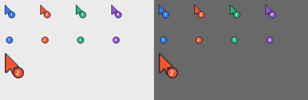

# Ordinateur à plusieurs

**Plusieurs souris, plusieurs claviers, un seul PC.** Branche 2 à 4 souris (et autant de claviers) sur un ordinateur Windows :
chaque souris reçoit son propre curseur, et plusieurs personnes peuvent se servir du même PC en même temps.



Chaque curseur est **la flèche de Windows elle-même** (même forme, même taille), recolorée, avec le numéro du joueur.
Au départ : joueur 1 bleu, 2 orange, 3 vert, 4 violet.

## Installation

1. Télécharge `MultiSouris.exe` dans les [Releases](../../releases/latest).
2. Lance-le : une icône avec deux curseurs apparaît près de l'horloge.
3. Branche une 2e souris et bouge-la : son curseur apparaît.

Il n'y a rien à installer (Windows 10 ou 11, .NET Framework 4 déjà présent dans Windows).
L'exe n'est pas signé : Windows SmartScreen peut afficher « Windows a protégé votre ordinateur » → *Informations complémentaires* → *Exécuter quand même*.

## Les souris

- Chaque joueur peut bouger, **cliquer** (gauche, droit, milieu, boutons de côté), faire un **glisser-déposer** et tourner la **molette**.
- Windows n'a qu'un seul vrai curseur : il va **au joueur qui bouge**. C'est lui qui voit les boutons s'allumer au survol
  (la croix rouge des fenêtres...), avec exactement la vitesse et l'accélération de Windows. Dès qu'il s'arrête un instant,
  ou qu'un autre joueur clique, le vrai curseur passe chez l'autre. Les joueurs qui ne l'ont pas gardent leur curseur dessiné ;
  celui qui l'a garde sa pastille de couleur à côté.
- Les petites secousses d'une main posée sur la souris ne comptent pas.

## Les claviers

- Chaque clavier va avec une souris : il n'écrit **qu'à l'endroit choisi par la souris de son joueur**.
  Si un autre joueur a cliqué dans une zone de texte, ton clavier n'y écrit pas.
- Si ton joueur a cliqué dans une autre fenêtre, ton clavier y retourne tout seul pour écrire.
- Le premier clavier utilisé après le clic d'un joueur lui revient. On peut changer dans le menu.
- Avec un seul clavier, il est partagé comme d'habitude.

## Le menu (clic droit sur l'icône)

Pour chaque joueur : **couleur**, **vitesse**, **taille du curseur dessiné** et **clavier**
(« Choisir son clavier » puis appuyer sur une touche de ce clavier). « Tout remettre comme le curseur principal »
redonne la vitesse et la taille de Windows. Il y a aussi pause, oublier les autres souris, lancer avec Windows et quitter.

- **Ctrl+Alt+F12** : pause (souris et claviers redeviennent normaux) / reprise.
- Une souris qui ne bouge pas pendant 10 minutes perd son curseur ; il revient dès qu'elle bouge.

## Sécurité

L'appli ne laisse jamais une souris ou un clavier bloqués :

- avec une seule souris, elle ne touche à rien ;
- si une souris ou un clavier n'est pas reconnu, elle repasse en mode normal ;
- si Windows débranche ses crochets, elle les remet et repasse en mode normal le temps qu'il faut ;
- devant une fenêtre « administrateur » (Gestionnaire des tâches...), elle repasse en mode normal le temps
  que cette fenêtre reste au premier plan. Pour que tout marche aussi dans ces fenêtres, lance `MultiSouris.exe` en administrateur.

## Comment ça marche

- **Raw Input** indique quelle souris ou quel clavier a envoyé chaque geste. Les souris « gamer » qui se présentent
  en plusieurs morceaux (`MI_00`, `MI_01`...) sont regroupées en remontant jusqu'à l'appareil USB ou Bluetooth commun.
- Dès qu'il y a 2 joueurs, des crochets bas niveau (`WH_MOUSE_LL`, `WH_KEYBOARD_LL`) bloquent les gestes des vrais appareils.
  L'appli renvoie elle-même ceux du joueur qui a le vrai curseur (`SendInput`) et les touches de chaque clavier vers la fenêtre de son joueur.
- Trois fils : un pour les crochets (il ne fait rien d'autre, pour répondre tout de suite à Windows même avec une souris à 1000 Hz),
  un pour Raw Input, et un pour l'icône et les curseurs dessinés (fenêtres transparentes toujours au premier plan).

## Compiler

```powershell
.\construire.ps1
```

Il utilise le compilateur C# livré avec Windows (`csc.exe` du .NET Framework 4), sans rien d'autre à installer.
`.\construire.ps1 -Relancer` arrête l'appli, recompile et la relance.

Journal pour le dépannage : créer un fichier vide `journal.on` à côté de `MultiSouris.exe` ; le journal s'écrit dans `journal.txt` à côté.
`MultiSouris.exe --essai` fait jouer deux fausses souris par les gestes marqués `0x7771` et `0x7772` (pour les tests).

## Licence

MIT
